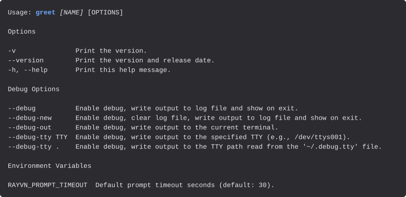

# rayvn

rayvn lets you create and maintain bash 5.3+ programs the way you would in other languages:

- use shared libraries, loaded with one line: built-in, your own or from other projects
- create projects, scripts, libraries and tests from templates
- run tests and lint
- generate docs and web sites
- release to GitHub, Homebrew and Nix

bash is everywhere, stable and small, and has been maintained and improved for decades; rayvn adds what larger
programs need, and makes it easy to write polished, high-quality ones, with:

- styled output with color themes
- interactive prompts and spinners
- generated argument parsing, with usage and shell completions
- configuration files
- keychain secrets and OAuth
- secure (RAM-backed) temporary files
- error handling and debug tracing

## First Look

A simple rayvn script:

```bash
#!/usr/bin/env rayvn-bash

usage() {
    show "Usage:" bold blue "${scriptName}" italic "[NAME]"
    bye "$@"
}

main() {
    init "$@"
    show primary "Hey ${name^}!"
}

init() {
    declare -g name
    while (( $# )); do
        case "$1" in
            -h | --help) usage ;;
            -* | --*) usage "unknown option: $1" ;;
            *) name="$1" ;;
        esac
        shift
    done
    [[ -n ${name} ]] || request "What's your name?" name || bye
}

source rayvn.up 'rayvn/prompt'
main "$@"
```

- `#!/usr/bin/env rayvn-bash` ensures bash 5.3+ if available, regardless of system defaults.
- `source rayvn.up 'rayvn/prompt'` bootstraps rayvn, sets `scriptName` and loads the libraries it names: here
  `rayvn/prompt` for `request`, which asks for the name if none was given. `rayvn/core`, with `show` for styled text
  output, is always loaded.
- All functions are defined before `source rayvn.up` so the file is fully parsed before `main` runs.

In a project (see [Creating a project](#creating-a-project)), the same script also takes the standard options for help, version and
debug output, as scripts made with `rayvn new script` do:

```bash
#!/usr/bin/env rayvn-bash

usage() {
    show "Usage:" bold blue "${scriptName}" italic "[NAME]" "[OPTIONS]"
    showCommonOptions --header
    bye "$@"
}

main() {
    init "$@"
    show primary "Hey ${name^}!"
}

init() {
    declare -g name
    while (( $# )); do
        case "$1" in
            -h | --help) usage ;;
            -v) projectVersion greet; exit 0 ;;
            --version) projectVersion greet true; exit 0 ;;
            --debug*) setDebug "$@"; shift $? ;;
            -*) usage "unknown option: $1" ;;
            *) name="$1" ;;
        esac
        shift
    done
    [[ -n ${name} ]] || request "What's your name?" name || bye
    debug "name: '${name}'"
}

source rayvn.up 'rayvn/prompt'
main "$@"
```

`greet --help` shows:



- `showCommonOptions` prints the standard options: version, help and debug, and the environment variables of the
  libraries loaded (here `RAYVN_PROMPT_TIMEOUT`, from `rayvn/prompt`).
- `setDebug` handles the `--debug` options, and `debug` writes only when one is given: `greet alex --debug-out` shows
  `name: 'alex'` in the terminal, and `greet alex --debug` writes it to a log, shown on exit (see
  [Debugging rayvn applications](#debugging-rayvn-applications)).
- `projectVersion greet` prints the version from the project's `rayvn.pkg`.

## Installation

rayvn can be installed with [Homebrew](https://brew.sh) or [Nix](https://nixos.org/): see
[Install with Homebrew](#install-with-homebrew) or [Install with Nix](#install-with-nix) below.

## Developing With rayvn

rayvn provides two tools for working with projects:

- **[CLI](https://rayvn.ink/rayvn/cli)** — scaffolding, testing, linting, releasing, and more.
- **[API](https://rayvn.ink/rayvn/api)** — shared libraries your scripts can `require`.

> **Note:** the `rayvn build`, `rayvn test --nix`, and `rayvn release` CLI commands require Nix. See [Installing Nix](#installing-nix).

### Creating a project

`cd` to the desired parent directory, then:

```bash
rayvn new project my-name          # creates the project and a GitHub repo (after prompt)
rayvn new project my-name --local  # local git repo only, no GitHub
```

From within the project, scaffold new components:

```bash
rayvn new script my-script    # adds bin/my-script
rayvn new library my-lib      # adds lib/my-lib.sh
rayvn new test my-test        # adds test/test-my-test.sh
```

All generated files are automatically staged in git.

## Using rayvn within scripts

All rayvn scripts use `#!/usr/bin/env rayvn-bash` as their shebang. `rayvn-bash` is a POSIX sh
wrapper that locates a suitable bash 5.3+ on the system (checking common locations and `PATH`,
with caching), then re-execs the script with it. This ensures scripts always run under the correct
bash version regardless of what `/bin/bash` or the shell's `PATH` provides.

The following line in your script will activate rayvn:
```bash
source rayvn.up
```

After that line executes, your script now has a `require` function which can then be used to load any installed shared library.
The `rayvn/core` library is loaded by default. For convenience, `rayvn.up` accepts a list of library names to immediately `require`:
```bash
source rayvn.up 'rayvn/prompt'
```

`rayvn.up` automatically detects other rayvn projects via `PATH`, so:

```bash
source rayvn.up 'valt/archive'

```
works if the `valt` project is in `PATH`. If a project is not in `PATH`, it can be added explicitly:

```bash
source rayvn.up 'myproject/mylibrary' --add myproject=/path/to/project
```

The `require` function can be called lazily, e.g. within a function.

Calling `require` multiple times for the same library will only load it on the first call, subsequent calls will just count the request.

To see public functions across all rayvn libraries, or in a specific one:
```bash
rayvn functions rayvn             # all libraries in the rayvn project
rayvn functions rayvn/core        # only rayvn/core
rayvn functions rayvn/core --all  # include private functions
```

Private functions have an underscore prefix and are **always** *subject to change*.

## Namespaces

Bash has a flat namespace: all functions and global variables from loaded libraries share the same scope. Potential collisions can
be managed via a mandatory prefix (e.g. `rayvn::`), but this adds development friction and is really only warranted when
wider adoption is expected.

For now, rayvn takes a best-effort approach:

- **Naming conventions**: Public functions use descriptive, naturally-scoped names (e.g. `addSpinner`, `cursorTo`). Private functions and variables are prefixed with `_` and are always subject to change.
- **Runtime enforcement**: `rayvn.up` marks all library functions readonly after loading, so a collision causes a hard error rather than a silent clobber, naming the conflicting libraries. This catches function collisions between libraries as they are loaded, but does not cover global variables.
- **Static analysis**: `rayvn collisions` scans locally-installed project libraries for function and global variable name collisions. It only sees whatever versions happen to be installed, so it is a development-time sanity check rather than a guarantee.
- **Escape hatches**: A declaration can be annotated with `# namespace-ok` to suppress a specific collision report, or a block can be wrapped in `# namespace-skip-start` / `# namespace-skip-end`.

If wider adoption does occur, a future (breaking) release may introduce mandatory function and global variable prefixes.

## Debugging rayvn applications

All rayvn applications support debug options via the `rayvn/debug` library. Use debug functions to generate diagnostic output that can be sent to a log file or separate terminal.

### Debug Options

```
--debug                   Enable debug logging, show log on exit
--debug-new               Enable debug logging with cleared log file, show log on exit
--debug-out               Send debug output to current terminal (uses tty)
--debug-tty /dev/ttys001  Send debug output to specific terminal device
--debug-tty .             Read tty path from ~/.debug.tty file
```

### Using Debug Functions

The debug options are processed by the `setDebug` function in `rayvn/core`. You can then use e.g.:

```bash
debug "processing item ${i} of ${total}"
debugVars myVar myArray myMap
debugTraceOn # set -x directed to debug output
cmd1
cmd2
debugTraceOff # set +x
```

Debug output is only generated when debug mode is enabled via the command-line options.

### Example

Direct TTY specification:
```bash
# Terminal 1: Find your TTY
$ tty
/dev/ttys001

# Terminal 2: Run your script with debug output to Terminal 1
$ my-rayvn-app --debug-tty /dev/ttys001
```

Using .debug.tty file:
```bash
# Terminal 1: Write your tty to the file
$ tty > ~/.debug.tty

# Terminal 2: Run your script
$ my-rayvn-app --debug-tty .
```

## API/CLI Documentation

See [rayvn.ink](https://rayvn.ink/rayvn/)

## IDE Configuration

### IntelliJ IDEA

The [BashSupport Pro](https://plugins.jetbrains.com/plugin/13841-bashsupport-pro) plugin is strongly
recommended — it provides full bash language support including syntax highlighting, code completion,
refactoring, and ShellCheck integration. It is far superior to the built-in shell script support.

After installing BashSupport Pro, register `rayvn-bash` as a recognized hashbang:

**Settings → Editor → File Types → Shell Script → Hashbangs** → add `rayvn-bash`

Then configure shared library sources and usage using your rayvn install location:

**Settings → Languages & Frameworks → BashSupport Pro → Shell Script Libraries**

- In **Library Sources**, add the `rayvn/lib` directory.
- In **Library Usage**, add the `rayvn/bin` and `rayvn/test` directories.

Do the same for any other rayvn projects you create or install.


### VS Code

VS Code doesn't support custom hashbang registration, but you can associate extensionless files in `bin/`
directories with the Shell Script language by adding this to your `settings.json`
(**File → Preferences → Settings → Open Settings JSON**):

```json
{
    "files.associations": {
        "*/bin/*": "shellscript"
    }
}
```

For linting, install the [ShellCheck extension](https://marketplace.visualstudio.com/items?itemName=timonwong.shellcheck). It will use the `#!/usr/bin/env rayvn-bash` shebang to infer bash dialect automatically once the file is recognized as a shell script.

## Install with Homebrew

If you don't have Homebrew yet, install it first (see [Installing Homebrew](#installing-homebrew)), then:

```bash
brew tap rayvn-central/tap
brew trust --tap rayvn-central/tap
brew install rayvn
```

Homebrew installs formulae from taps other than its own only once you trust them, hence `brew trust`. Homebrew
installs rayvn's dependencies with it.

To upgrade to the latest version:

```bash
brew upgrade rayvn
```

### Installing Homebrew

**Mac and Linux:**

```bash
/bin/bash -c "$(curl -fsSL https://raw.githubusercontent.com/Homebrew/install/HEAD/install.sh)"
```

On a Mac, this also installs Apple's Command Line Tools if they are missing; or download and run the `.pkg` installer
from [Homebrew's latest release](https://github.com/Homebrew/brew/releases/latest) instead. On Linux, first install the
tools it needs, e.g. on Debian or Ubuntu: `sudo apt-get install build-essential procps curl file git`.

**Windows:** Homebrew runs in Windows' own Linux environment, WSL. In PowerShell as administrator, run `wsl --install`,
restart, open Ubuntu from the Start menu, and follow the Linux step above inside it (see
[Install WSL](https://learn.microsoft.com/windows/wsl/install)). Windows files are under `/mnt/c` there.

When it finishes, the installer shows **Next steps**: run the commands it gives to add `brew` to your PATH, then open a
new terminal before continuing.

To remove Homebrew later, see [How do I uninstall Homebrew?](https://docs.brew.sh/FAQ#how-do-i-uninstall-homebrew).

## Install with Nix

If you don't have Nix yet, install it first (see [Installing Nix](#installing-nix)), then:

```bash
nix profile add github:phoggy/rayvn
```

To install a specific version:

```bash
nix profile add github:phoggy/rayvn/v0.5.0
```

To upgrade to the latest version:

```bash
nix profile upgrade rayvn
```

To run without installing:

```bash
nix run github:phoggy/rayvn
```

All dependencies are declared in the `flake.nix` file in the `runtimeDeps` list. New dependencies must be added there.

### Installing Nix

**Mac with Apple silicon:** Download and run the [Determinate Nix installer](https://dtr.mn/determinate-nix).

**Mac x86:**

```bash
curl -L https://nixos.org/nix/install | sh
```

**Linux:**

```bash
curl --proto '=https' --tlsv1.2 -sSf -L https://install.determinate.systems/nix | sh -s -- install
```

**Windows:** Nix runs in Windows' own Linux environment, WSL. In PowerShell as administrator, run `wsl --install`,
restart, open Ubuntu from the Start menu, and follow the Linux step above inside it (see
[Install WSL](https://learn.microsoft.com/windows/wsl/install)). Windows files are under `/mnt/c` there.

All installers create a `/nix` volume and take a few minutes to complete. Answer yes to any prompts and allow any
system dialogs that pop up. Once complete, open a new terminal before continuing.

If you used the Mac x86 installer, enable flakes:

```bash
mkdir -p ~/.config/nix
echo 'experimental-features = nix-command flakes' >> ~/.config/nix/nix.conf
```

To remove Nix later: after the Determinate installer, run `/nix/nix-installer uninstall`; after the Mac x86 one, see
[Uninstalling Nix](https://nix.dev/manual/nix/latest/installation/uninstall).

## Optional: RAM-backed Temp Storage

rayvn's secure temporary files (`makeSecureTempDir`) are kept in RAM-backed storage when possible, so that sensitive
files stay out of persistent storage entirely:

- **Linux:** `/dev/shm` is used automatically: nothing to configure.
- **macOS 10.15+:** a RAM disk is created each time one is needed, which takes a second or two. To skip that, set up a
  tmpfs mount once, with `rayvn-tmp`:

```bash
rayvn-tmp status     # show current strategy and instructions
rayvn-tmp install    # install a LaunchDaemon to mount it at boot (requires sudo)
rayvn-tmp uninstall  # remove the LaunchDaemon (requires sudo)
```

Otherwise, a mode-600 temp directory on disk is used, and callers are told so, to warn or abort.

## Shell Completions

Homebrew and Nix installations include bash completions automatically. To activate them,
ensure [bash-completion](https://github.com/scop/bash-completion) is configured in your shell
(typically via your package manager).

If you cloned the repo, add to `~/.bash_profile`:

```bash
source /path/to/rayvn/completions/rayvn.bash
```
